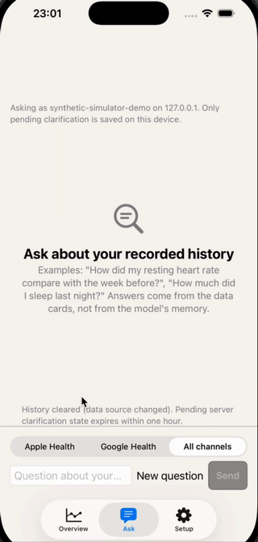
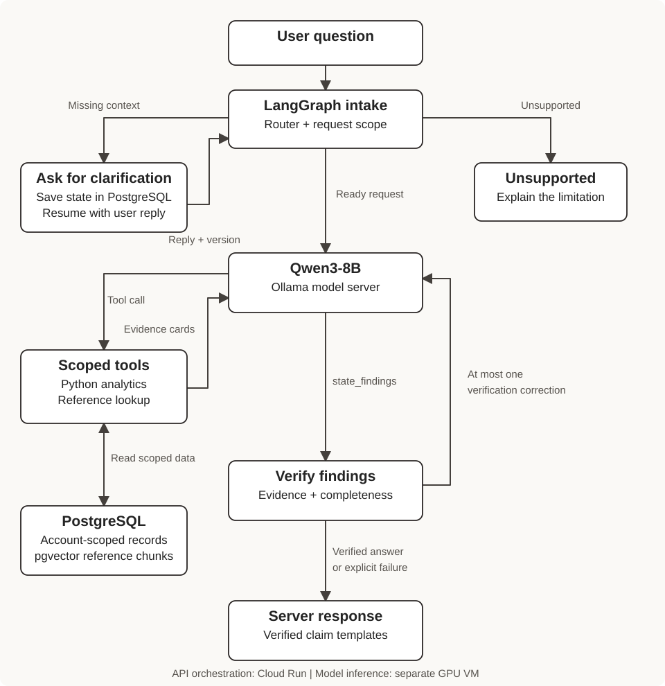

# HealthOps

**A multi-device health-data assistant that asks for missing context and answers from verified evidence.**

<p align="center">
  <a href="https://github.com/user-attachments/assets/b48fbd5a-e1a3-4203-9662-f1ace9257a62">
    
  </a>
</p>
<p align="center">
  <a href="https://github.com/user-attachments/assets/b48fbd5a-e1a3-4203-9662-f1ace9257a62"><strong>Watch the full demo with audio</strong></a><br>
  <sub>iOS Simulator · Synthetic account · Live Qwen3-8B</sub>
</p>

HealthOps combines Apple HealthKit and Google Health / Fitbit records with a Qwen3-8B assistant.
Personal numerical answers come from deterministic Python tools; a pgvector reference library
supports sourced definitions. The same model selects tools, while the server controls identity,
request scope, evidence validation and the final claim rendering.

Built with **FastAPI, LangGraph, PostgreSQL + pgvector, SwiftUI, Ollama and Google Cloud**.
This is an engineering prototype with fixed synthetic evaluations, not a clinical product or
an always-on public service.

## See the interaction

```text
User:       How have I been doing recently?
Assistant:  Requests the missing time range and metrics.
User:       Past 7 days; steps and sleep duration.
Assistant:  Resumes the scoped conversation, queries both metrics, validates evidence,
            and reports each requested metric, including missing records.
```

This is an illustrative interaction, not a transcript or a claim about a specific model run.

- **Native app:** [SwiftUI client and build instructions](src/frontend-app/HealthOpsUploader/README.md).
- **UI preview:** [interactive HTML prototype](src/frontend-app/prototype/README.md).
  Run `python3 -m http.server 8765 --bind 127.0.0.1 --directory src/frontend-app/prototype`.
  It uses scripted synthetic examples and does not call the API or model.
- **Recorded native demo:** [watch the 37-second Simulator video](https://github.com/user-attachments/assets/b48fbd5a-e1a3-4203-9662-f1ace9257a62).
  Live Qwen3-8B, synthetic account, local backend; original audio preserved.
  [Runtime, editing disclosure and phone acceptance checklist](docs/demo/README.md).

## Design that matters

- **Clarify before querying.** A typed Router distinguishes ready, underspecified and unsupported
  requests. PostgreSQL stores account-bound clarification state with expiry and version checks.
- **One model, dynamic tools.** A LangGraph execution loop lets Qwen select data tools or reference
  lookup, inspect results and submit `state_findings`. It does not force RAG to be a fallback.
- **Evidence controls the answer.** Python validates evidence references and claims, checks the
  entire requested scope, and permits one bounded verification correction. Verified templates
  render the final sentences; unrestricted model prose is not presented as verified fact.
- **Defense in layers.** Server-injected user identity, registered tool schemas, execution budgets,
  retrieved-content injection screening and quote limits constrain the workflow. Screening is
  heuristic; these checks do not establish universal prompt-injection resistance.



Cloud Run hosts the API and orchestration. Model inference runs on a separate GPU VM.
See [architecture and limitations](docs/architecture.md).

## Observed evaluation

Qwen3-8B Q4_K_M, Ollama 0.35.1, temperature 0, thinking disabled; Cloud Run API,
synthetic Cloud SQL data and a temporary V100 model server. Reported run: **2026-11-02 UTC**.

| Fixed evaluation suite | Scenarios | User turns | Scenario pass rate |
| --- | ---: | ---: | ---: |
| End-to-end diagnostic | 60 | 84 | **59/60 (98.3%)** |
| Interaction suite | 36 | 72 | **32/36 (88.9%)** |
| RAG routing only, excluded from end-to-end scores | 3 | 3 | 3/3 tool selection |

The first two rows total **96 scenarios / 156 turns**. All three total **99 / 159**.
Templates repeat across three synthetic accounts; follow-up replies are authored fixtures.
These are fixed development diagnostics, not held-out production accuracy or clinical validation.
Both suites include multi-turn behavior. The RAG routing checks did not establish successful retrieval.

Known failures: two reproducible empty model answers after correct tool execution; three
availability-versus-summary contract mismatches; SDNN retrieval below the similarity threshold.
See the [full report](docs/evidence/v100-live-evaluation-20261102.md),
[question-set guide](docs/assistant-routed-evaluation.md) and [evaluation index](docs/evidence/README.md).

## Reproduce locally

Start with the [synthetic quickstart](docs/quickstart.md). It needs Docker Compose; live answers
also need host Ollama with `qwen3:8b`. No Google account, private dataset, OAuth credentials or
service-account JSON is needed for the public fixture demo. Python development uses 3.12 + uv.

```bash
make app       # local PostgreSQL, migrations and API
make test      # isolated ephemeral PostgreSQL integration suite
```

The public fixture generator reproduces ingestion, tools and the assistant interface. Replaying
the exact reported three-account scores additionally requires the team's versioned synthetic
cohort and frozen run inputs; those datasets and private artifacts are not published here.
Optional reference ingestion: `make rag` after pulling `nomic-embed-text`; this downloads
manifest-listed third-party sources under their recorded usage terms.

## Code map

| Component | Start here |
| --- | --- |
| API, identity and observation ingestion | [API service](src/api-service/README.md) |
| Router and persistent clarification | [clarification contract](docs/assistant-clarification.md) |
| Scope, evidence and completeness | [execution guards](docs/assistant-execution-guards.md) |
| Reference retrieval and content screening | [knowledge library](knowledge/README.md), [safety design](docs/design/reference-safety.md) |
| Native app and interaction design | [frontend](src/frontend-app/README.md), [UX specification](docs/design/assistant-experience.md) |
| Cloud Run / Cloud SQL / model VM | [deployment guide](src/deployment/cloud-run/README.md) |
| Local verification of this migration | [verification record](docs/evidence/portfolio-migration.md) |

## Authorship and scope

**Developed by Zhentian Wu.** This repository contains my HealthOps application and assistant
work: ingestion and authentication, deterministic analytics, LangGraph orchestration, reference
retrieval, the iOS client, application deployment and evaluation.

HealthOps was also developed within the [AC215 team project](https://github.com/HuihanCui/ac215_Megatron).
The team's synthetic-data generation and cross-device discrepancy training are maintained
separately and are not included here. Their trained reconciliation predictions are not yet
connected to this assistant. Shared project conventions and source history are documented in
[provenance and acknowledgments](docs/provenance.md).

Model fine-tuning is a future experiment, not the source of the reported scores.
Credentials, health records, downloaded corpora and raw run artifacts are excluded from Git.
