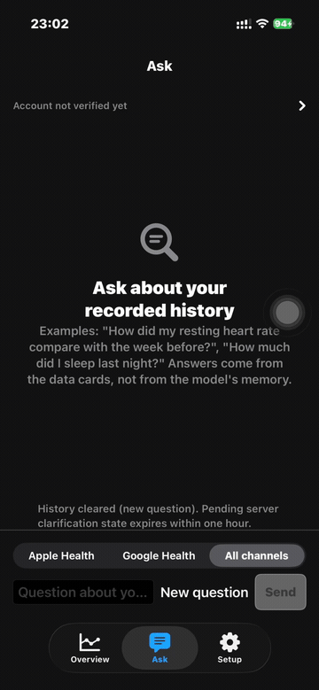
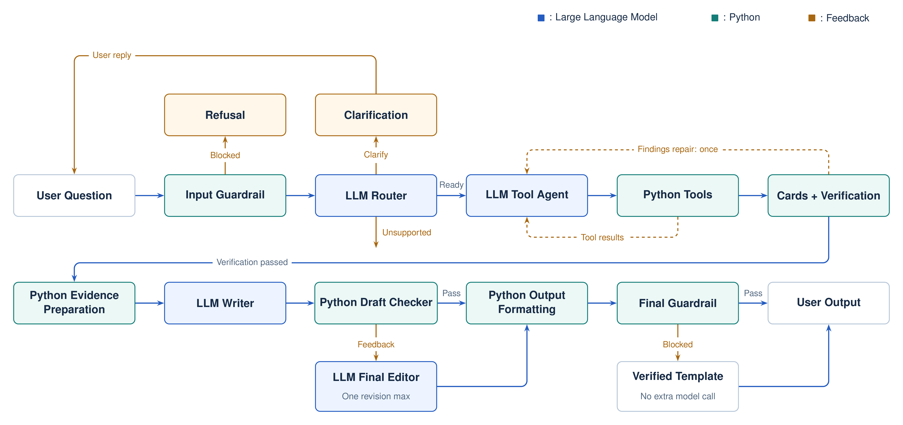

# HealthOps

**A multi-device health-data assistant that asks for missing context and answers from verified evidence.**

<p align="center">
  <a href="docs/demo/app-demo.mp4">
    
  </a>
</p>
<p align="center">
  <a href="docs/demo/app-demo.mp4"><strong>Watch the full 25-second demo</strong></a><br>
  <sub>November 12, 2026 · iOS app · Clarification, answers and evidence</sub>
</p>

HealthOps combines Apple HealthKit and Google Health / Fitbit records with a Qwen3-8B assistant.
Recorded-history summaries come from deterministic Python tools; a pgvector reference library
supports sourced definitions. A trained Transformer provides cross-device reconciliation estimates
when its pinned weights are configured. The base Qwen model selects tools; a configurable
Writer model explains the resulting evidence. Python controls identity, request scope,
structured claims and display formatting. Generated prose is distinguished from verified evidence.

Built with **FastAPI, LangGraph, PostgreSQL + pgvector, SwiftUI, PyTorch, Ollama and Google Cloud**.
This is an engineering prototype with fixed synthetic evaluations, not a clinical product or
an always-on public service.

## See the interaction

```text
User:       How have I been doing recently?
Assistant:  Requests the missing time range and metrics.
User:       Past 7 days; steps and sleep duration.
Assistant:  Resumes the scoped conversation, queries both metrics, validates evidence,
            and reports each requested metric, including missing records.
```

This is an illustrative interaction, not a transcript or a claim about a specific model run.

- **Native app:** [SwiftUI client and build instructions](src/frontend-app/HealthOpsUploader/README.md).
- **UI preview:** [interactive HTML prototype](src/frontend-app/prototype/README.md).
  Run `python3 -m http.server 8765 --bind 127.0.0.1 --directory src/frontend-app/prototype`.
  It uses scripted synthetic examples and does not call the API or model.
- **Recorded native demo:** [watch the 25-second app video](docs/demo/app-demo.mp4).
  Select sleep duration and active energy, specify the past seven days, then inspect the answer
  and evidence. [Recording details and export settings](docs/demo/README.md).

## Design that matters

- **Clarify before querying.** A typed Router distinguishes ready, underspecified and unsupported
  requests. PostgreSQL stores account-bound clarification state with expiry and version checks.
- **Dynamic tools, stable routing.** A LangGraph execution loop lets the base Qwen model select history tools,
  reference lookup or `reconcile_devices`, inspect results and submit `state_findings`.
  Reconciliation reports model estimates, intervals and coverage warnings alongside recorded
  values; it does not establish a device's true accuracy.
- **Check evidence before writing.** Python validates structured claims against evidence cards,
  checks the requested scope and permits one bounded findings correction. For daily summaries,
  Python can then complete omitted coverage from already-fetched, exactly scoped cards; it
  cannot repair invalid claims or invent missing readings. Verified templates precede the Writer.
- **Grounded writing, bounded editing.** Python prepares the evidence and readable units. Writer
  and Editor use the same model, which can be configured separately from the base routing/tool
  model. Draft checks can trigger one Editor revision. Formatting and a final
  sensitive-output check follow, with template fallback for blocked or unusable output. Generated
  prose is labeled separately: the final gate does not revalidate every edited factual claim.
- **Defense in layers.** Input screening, server-injected identity, registered tool schemas,
  execution budgets, reference screening and quote limits constrain the workflow. Personal and
  synthetic uploads are checked at both client and API boundaries. These checks have documented
  limits; they do not establish universal prompt-injection resistance.



Cloud Run hosts the API and orchestration; Qwen inference runs on a separate GPU VM.
The reconciliation model runs inside the API when configured. See the
[deployment guide](src/deployment/cloud-run/README.md), [reconciliation contract](docs/reconciliation.md)
and [assistant guardrails](docs/assistant-guardrails.md).

## Observed evaluation

| Evaluation | Cases / scenarios | Metric | Result |
| --- | ---: | --- | ---: |
| End-to-end live scenarios | 93 | Task success | **86.0%** |
| Offline answers — Base Qwen3-8B | 112 | Answer acceptance | **80.4%** |
| Offline answers — DPO-fine-tuned Qwen3-8B | 112 | Answer acceptance | **91.1%** |

DPO improved answer acceptance from **80.4% to 91.1%** across 112 offline cases
(**+10.7 percentage points**). The live end-to-end result is a separate evaluation;
offline answer acceptance and live task success measure different scopes.
See [evaluation scope and source notes](docs/evidence/portfolio-results-20261113.md).

## Reproduce locally

Start with the [synthetic quickstart](docs/quickstart.md). It needs Docker Compose; live answers
also need host Ollama with `qwen3:8b`. No Google account, private dataset, OAuth credentials or
service-account JSON is needed for the public fixture demo. Python development uses 3.12 + uv.

```bash
make app       # local PostgreSQL, migrations and API
make test      # isolated ephemeral PostgreSQL integration suite
```

The public fixture generator reproduces ingestion, tools and the assistant interface. Replaying
the reported evaluation scores additionally requires the corresponding versioned datasets,
frozen run inputs and model checkpoints; those private artifacts are not published here.
Optional reference ingestion: `make rag` after pulling `nomic-embed-text`; this downloads
manifest-listed third-party sources under their recorded usage terms.

Device reconciliation additionally needs the pinned model artifact and optional inference
extra; follow the [reconciliation setup](docs/reconciliation.md). The versioned data pipeline,
reconciliation training and Writer DPO workflows have separate service guides below.
They are not prerequisites for the public fixture demo.

## Code map

| Component | Start here |
| --- | --- |
| API, identity and observation ingestion | [API service](src/api-service/README.md) |
| Router and persistent clarification | [clarification contract](docs/assistant-clarification.md) |
| Scope, evidence and completeness | [execution guards](docs/assistant-execution-guards.md) |
| Writer, Editor and output checks | [writer implementation](src/api-service/healthops/assistant/narrative.py), [guardrails](docs/assistant-guardrails.md) |
| Independent Writer model selection | [API configuration](src/api-service/README.md), [deployment](src/deployment/cloud-run/README.md) |
| Device reconciliation and model serving | [reconciliation guide](docs/reconciliation.md) |
| Reference retrieval and content screening | [knowledge library](knowledge/README.md), [safety design](docs/design/reference-safety.md) |
| Native app and interaction design | [frontend](src/frontend-app/README.md), [UX specification](docs/design/assistant-experience.md) |
| Versioned data and synthetic cohort | [data guide](data/README.md), [synthesizer](src/data-synthesizer/README.md) |
| Reconciliation training and ML workflow | [model training](src/model-training/README.md), [Vertex pipeline](src/ml-workflow/README.md) |
| Writer preference training and checkpoints | [Writer DPO guide](src/model-training/writer_dpo/README.md) |
| Cloud Run / Cloud SQL / model VM | [deployment guide](src/deployment/cloud-run/README.md) |
| Monitoring | [dashboards and alerts](src/deployment/monitoring/README.md) |
| Local verification of the synchronized code | [verification record](docs/evidence/portfolio-sync-20261113.md) |

## Authorship and scope

**Project idea, application and assistant by Zhentian Wu.** I proposed HealthOps and directed
the project template and setup. My implementation work covers ingestion and authentication,
deterministic analytics, LangGraph orchestration, reference retrieval, the iOS client,
Writer post-training/evaluation tooling, deployment and monitoring.

HealthOps was developed within the [AC215 team project](https://github.com/HuihanCui/ac215_Megatron).
This repository also includes the team's data generation, processing, versioning and
cross-device model-training work, with contributions from Huihan Cui and Helena Li.
The reconciliation adapter connects trained predictions to the assistant's evidence cards.
See the [contribution table](contributions-table.md) and
[provenance and acknowledgments](docs/provenance.md) for ownership and source history.

Writer DPO training, checkpoint evaluation and registry workflows are included. The offline
results above compare base and DPO-fine-tuned Qwen3-8B; the live result is reported separately.
Credentials, personal health records, downloaded corpora and private run artifacts are
excluded from Git.
