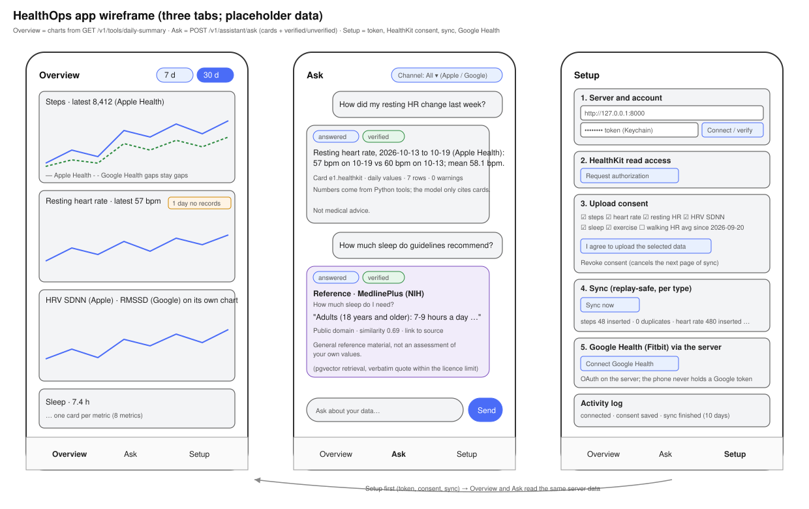
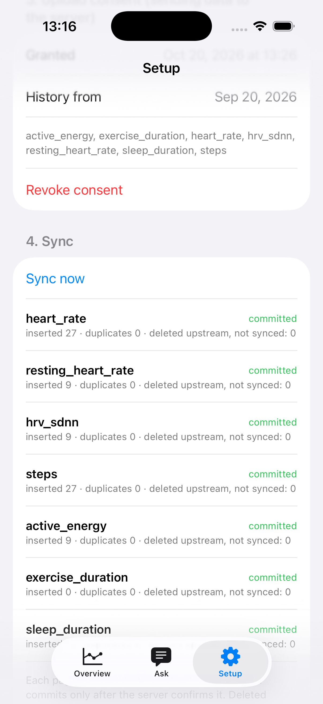
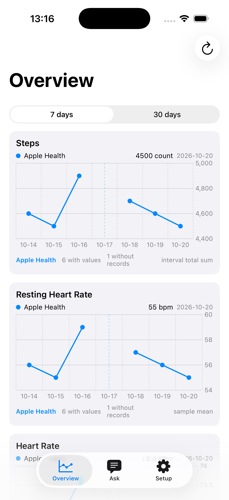
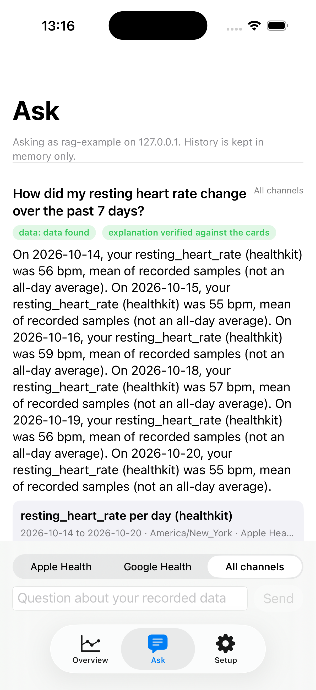
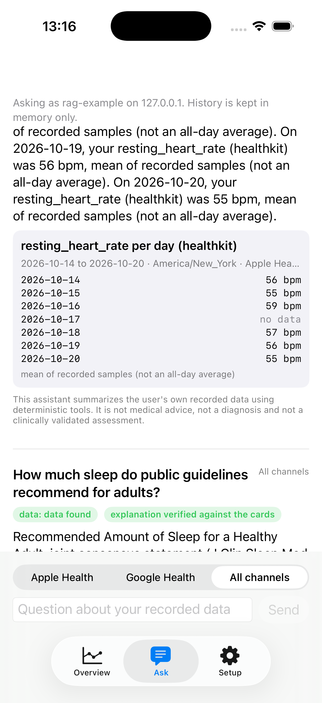
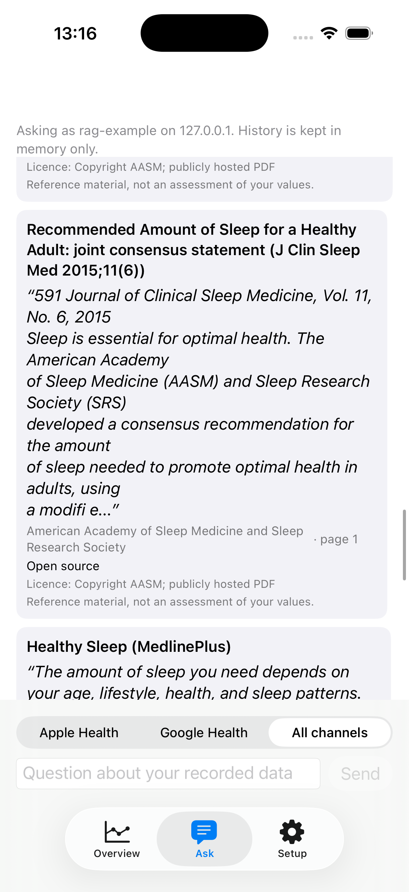

# Application mock-up and working skeleton

Milestone 2 deliverable 5: "Application mock-up/wireframe plus a minimal working app skeleton
showing basic UI and back-end interaction." This folder holds the wireframe, screenshots of the
working iOS app talking to the local API, and the changes since the Milestone 1 design.

Everything here runs locally: the iOS Simulator (iPhone 17 Pro, Xcode 26) against the API in
Docker Compose on the same Mac (`http://127.0.0.1:8000`) and an Ollama on the Mac for the
assistant. The HealthKit samples are synthetic, written by the app's debug-only seeder; the
account is a synthetic test user. No personal health data appears.

## Wireframe

`wireframe.svg`: the three tabs and the one path through them. Setup comes first (server and
token, HealthKit read access, upload consent, sync, optional Google Health); Overview and Ask
then read the same server data. Placeholder values only.

## The working skeleton: UI and back-end interaction

| Screen | Screenshot | What the back end does |
|---|---|---|
| Setup: consent granted and sync committed |  | `GET /v1/me` verifies the token; `POST /v1/observations/batch` receives each page (200 samples max) and answers `{received, inserted, duplicates}`; the phone commits its HealthKit anchor only after the 200. Per-metric counts come from the server's reply. |
| Overview: one chart per metric, 7 or 30 days |  | `GET /v1/tools/daily-summary` per metric; the server computes one value per local day and provider (sample mean or interval total), the phone draws without summing or interpolating. The dashed column is a day with no records, kept as a gap. |
| Ask: a question about the user's own data |  | `POST /v1/assistant/ask`: the model picks `daily_summary`, Python computes the card, the model cites `value_on_date` findings, the server verifies each against the card and renders the sentences. Two chips: data status and explanation status. |
| Ask: a definitional question answered from the reference library |   | Same endpoint; the model calls `lookup_reference`, pgvector returns the top passages, the answer quotes one verbatim within the source's licence limit and labels it as general reference material. |

How to reproduce: `docker compose up -d --build api` from the repository root, run Ollama with
`qwen3:8b` and `nomic-embed-text`, start the API on the host with the assistant variables from
`.env.example` (or set them on the container), build the app for the Simulator as described in
`src/frontend-app/HealthOpsUploader/README.md`, create a test user with
`healthops create-user`, then in the app: Setup → save token → connect → request HealthKit
access → "Write synthetic samples into the Simulator" (debug section) → consent → sync.

## Refined since Milestone 1

The Milestone 1 proposal sketched three screens (Figure 1 of the proposal): Data Connections,
Health Overview and HealthOps Chat. The same three screens exist, with these changes made while
implementing and testing on a physical phone against the cloud deployment:

| Milestone 1 design | Now | Why |
|---|---|---|
| "Data Connections: connect Apple HealthKit and Fitbit, view sync status" | Setup tab with five numbered steps; HealthKit read access and upload consent are separate steps, consent lists the metrics and a history start date, and the sync log shows inserted, duplicate, upstream-deleted and unmappable counts per metric | Users confused "reading on the phone" with "sending to the server"; consent must be explicit and revocable; replay-safe sync needed visible counts to debug on a real device |
| Fitbit "connected from the phone" | Google Health connected through the server (OAuth on the server, encrypted refresh token, the phone never holds a Google token) | Keeps secrets off the phone; one place to refresh tokens and report conflicts |
| "Health Overview with cross-device comparisons" | One chart per metric with one line per channel (Apple Health, Google Health); HRV SDNN and RMSSD are separate charts; gaps stay gaps | SDNN and RMSSD are different definitions and cannot share an axis; a comparison line that silently interpolates would hide missing data |
| "Chat with responses that communicate data source and uncertainty" | Ask tab with a channel selector, two status chips (data status, explanation status), data cards under each answer, and reference cards with source, licence and link; the model never writes numbers | Verification moved to the server: fixed templates, cards, and a fallback text when a claim does not check out; the phone decodes only display fields |
| Not in the Milestone 1 sketch | Onboarding text on the empty Overview ("three steps before the first chart"), clear failure messages (service unavailable, token expired, too many questions) | Found necessary during device testing when the cloud VM was stopped or a token expired |

Planned beyond Milestone 2: wellness check-ins (soreness, fatigue, stress) as a third data
channel, cross-channel comparison cards, and loading the synthetic cohort
(`data/synthetic/synthetic-v0.1`) into the API for evaluation at scale.
