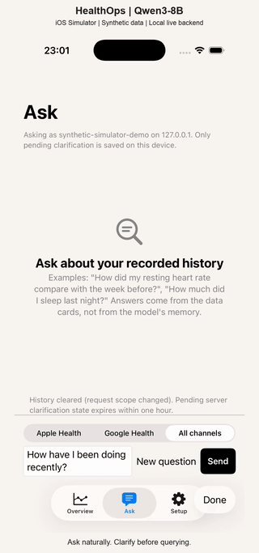

# Native iOS Simulator demo

[Download the 37-second video with original audio](simulator-demo.mp4)

Captured on 2026-11-02 UTC from the real SwiftUI application, using a dedicated synthetic
account and live Qwen3-8B inference. This is not the scripted HTML prototype and is not a
physical-iPhone recording. No application code or model responses were changed for the video.

## What the recording shows

1. Ask: `How did I do recently?`
2. Receive clarification choices for the missing metrics and time range.
3. Select `heart_rate`, `resting_heart_rate` and `steps`, then confirm without a time range.
4. Receive another clarification for the remaining time range; select `past 7 days`.
5. Receive an answer verified against the evidence cards, then scroll through the results.

This is a three-user-turn interaction: the question, the metric selection and the time selection.
The data-source picker is **All channels**. The answer covers seven days per metric, using synthetic
`healthkit` heart-rate records and synthetic `google_health` step records. These source labels do
not establish that a real wearable was read. The answer is an evidence-based coverage summary,
not a clinical assessment of wellbeing. This recording does not demonstrate missing-data handling.

## Runtime and data boundary

- Native client: iPhone 17 Simulator, iOS 26.3, Debug build from application commit `3f2da45`.
- API and PostgreSQL: fresh local Docker Compose project `healthops-recording`, with its own volume.
- Model: local Ollama **0.35.0**, Apple M4 Pro / Metal, `qwen3:8b` Q4_K_M.
- Model digest: `500a1f067a9f782620b40bee6f7b0c89e17ae61f686b92c24933e4ca4b2b8b41`.
- Account: `synthetic-simulator-demo`; 259 generated observations uploaded through the ingestion API.
- Data generator: `src/api-service/eval/synthetic_history.py`; its in-memory `TODAY` was set to
  **2026-11-01** before calling `observations()`. The checked-in generator and API clock were unchanged.
  This makes the demo's actual past-seven-day scope 2026-10-26 through 2026-11-01 in America/New_York.
- No personal database, real HealthKit history, cloud VM or OAuth connection was used.

The local demo is separate from the reported cloud evaluation (Ollama 0.35.1 and V100).
It adds one observed interaction, not a new accuracy or latency benchmark. RAG, real-device
HealthKit ingestion, OAuth sync, app restart recovery and network failure recovery are not
established by this recording.

## Video and audio

The developer recorded and edited this 36.93-second walkthrough, including the scrolling and
original audio. The published MP4 preserves that supplied edit and its timing. It is H.264,
1080 x 2264, 30 fps, approximately 4.6 MB, with AAC stereo audio. The original AAC stream was
copied without re-encoding; its packet checksum matches the supplied recording. The source
sound is quiet. Turn on the player's sound and adjust playback volume as needed.

The centered homepage GIF is a silent 320-pixel-wide, 10 fps preview. Open the MP4 for sound.
Publishing added no further cuts, speed changes or replacement answer frames. Video compression
and removal of container metadata reduce download size; the original export remains local.
Do not use an edited demonstration to infer response latency.

## Reproduce and accept on a phone

Follow the [synthetic quickstart](../quickstart.md) and
[native client guide](../../src/frontend-app/HealthOpsUploader/README.md). The quickstart's
unmodified fixture dates end on 2026-10-02: use explicit matching dates or deliberately generate
a new synthetic cohort for the current date. Do not change the server clock to hide missing data.

For physical-iPhone acceptance, use a reachable API with a dedicated synthetic account.
`127.0.0.1` on an iPhone refers to the phone, not this Mac. Verify the endpoint and account before
asking; do not enable personal HealthKit upload for this synthetic acceptance.

Check: ambiguous question -> visible choices and free text -> confirmed scope -> verified answer
-> all requested metric cards. Separately check missing-data handling. Also test keyboard dismissal, scrolling,
clarification after app relaunch, and an intentional disconnected-network error. Record those
results separately; they remain pending for this build.
