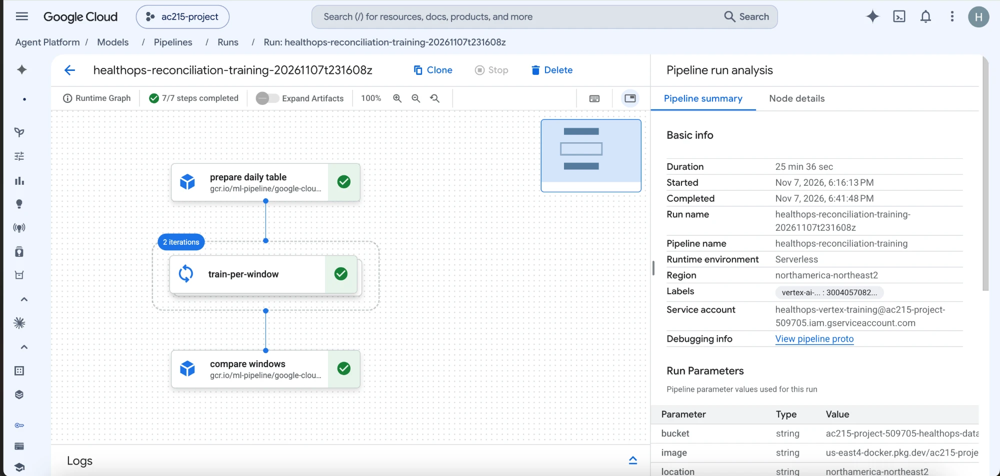
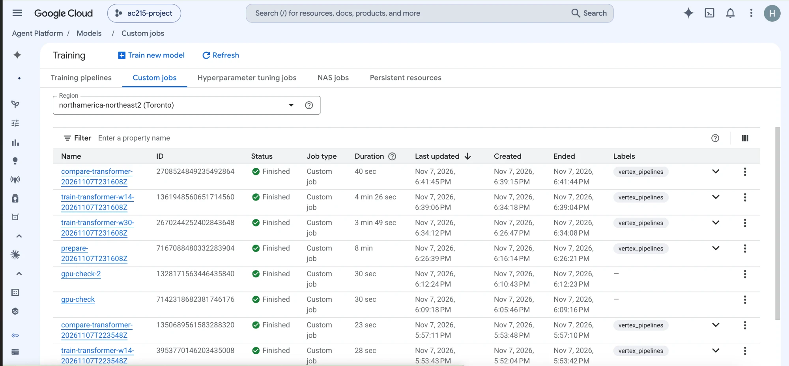
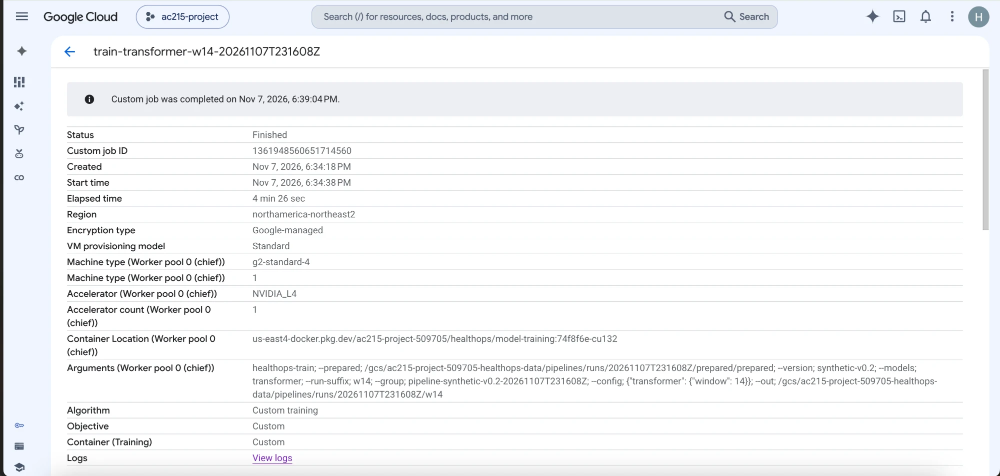
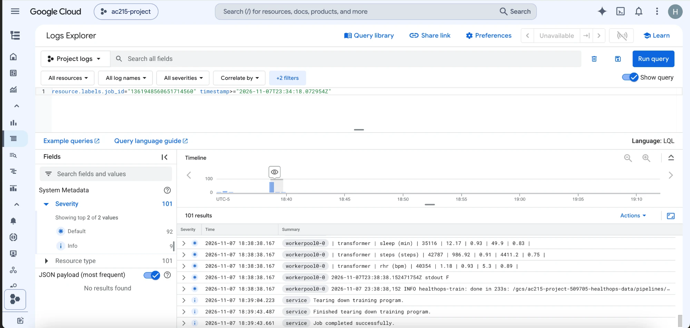
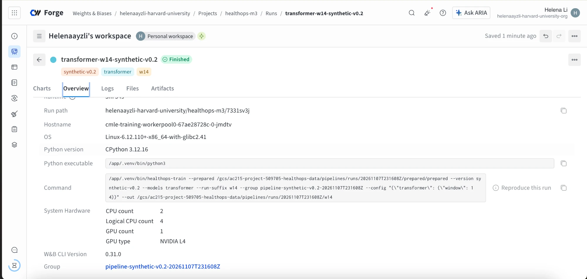
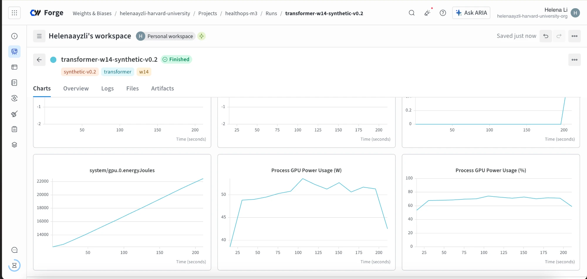
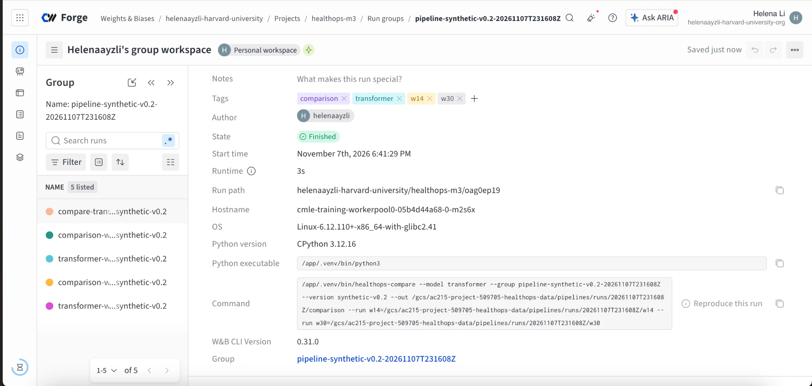
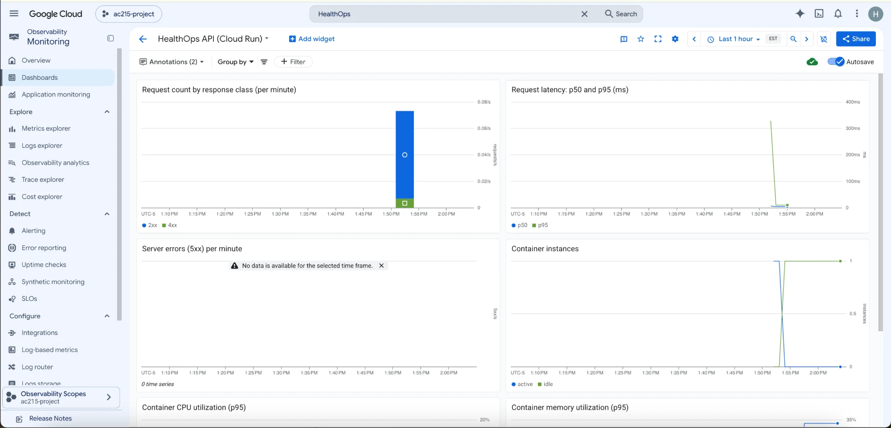
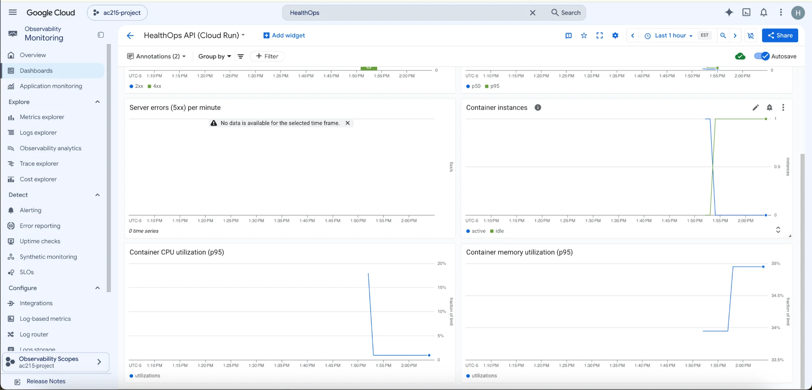
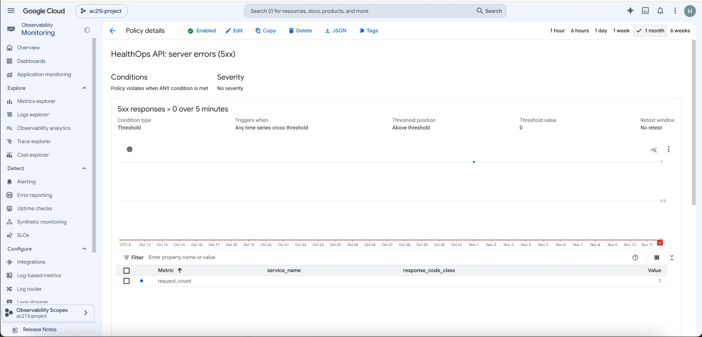

# Screenshots of running instances

Milestone 2 deliverable "screenshot of running instances" (local). Everything runs on one
development machine with Docker Compose; the cloud VM described in
`docs/cloud-dev-deployment.md` runs the same Compose services and is optional. All captures
show synthetic or public data only; no personal health records appear.

| File | What it shows | Captured |
|---|---|---|
| `local-compose-stack.png` | After `docker compose up -d --build api`: the `api` and `db` (`pgvector/pgvector:pg17`) containers healthy on 127.0.0.1, `/health/ready` and `/health/live`, pgvector 0.8.7 enabled, 570 reference chunks at migration head `0004`, container resource usage and the built images (api, migrate, test, rag-ingest) | 2026-10-19, Mac M4 Pro |
| `make-rag-ingest.png` | The one-command RAG pipeline (`make rag`): database and migration start, each source verified against its manifest sha256, then chunked and embedded with `nomic-embed-text` through the host Ollama; 12 sources, 570 chunks | 2026-10-19, Mac M4 Pro |
| `api-swagger-docs.png` | The API's OpenAPI page at `http://127.0.0.1:8000/docs` served by the running container | 2026-10-19 |
| `data-pipeline-run.png` | The data pipeline (`make run`): synthea-generator, data-collector, data-processor and data-synthesizer each log their input and output data versions and the Git commit; `docker compose --profile data ps -a` shows all four exited with code 0 | 2026-10-21, WSL Ubuntu |

The data pipeline's run logs and a sample input → output are in [../evidence/](../evidence/README.md); its manifests are in `data/manifests/`.

## Milestone 3: training on Vertex AI, the pipeline, and W&B

All of these were captured on 7 November 2026 from the project's cloud console and from our
Weights & Biases project, right after the pipeline run we use as the run of record
(`20261107T231608Z`, Toronto region, NVIDIA L4). Everything on screen is synthetic data; the
numbers behind the pictures are in
[../evidence/pipeline-window-comparison.md](../evidence/pipeline-window-comparison.md).

### The pipeline

`vertex-pipeline-run.png`: the Vertex AI Pipelines page for the run. The graph is the whole
workflow: *prepare daily table* builds the one-row-per-user-day table, *train-per-window* loops
over the two context windows (the "2 iterations" badge), and *compare windows* merges the two
results. All seven steps completed in 25 min 36 s. The right-hand panel shows the service account
the steps ran as and the parameters we passed (bucket, image, region, windows).

### The training jobs and the GPU

`vertex-custom-jobs.png`: the custom jobs the pipeline created, in the Toronto region. Prepare
took 8 minutes on a CPU machine; the two Transformer trainings took 4 min 26 s and 3 min 49 s on
the GPU machines; compare took 40 seconds. The two `gpu-check` jobs above them are the probe we
ran to confirm that PyTorch could see the L4 inside our container before launching the real run.

`vertex-training-job-gpu.png`: the detail page of `train-transformer-w14-20261107T231608Z`.
This is the proof of what the step ran on: machine type `g2-standard-4`, accelerator `NVIDIA_L4`,
count 1, container `model-training:74f8f6e-cu132` (the CUDA build of our image), and the exact
arguments, including `--config {"transformer": {"window": 14}}`.

`vertex-training-job-logs.png`: Cloud Logging for the same job, queried with
`resource.labels.job_id="1361948560651714560"`. The `workerpool0-0` lines are our training
program's own output: the per-metric result rows (sleep 12.17 min, steps 986.92, resting HR
1.18 bpm, each with its coverage, width and attribution) and `healthops-train: done in 233s`,
followed by the service's teardown messages. This is where the logs of every job end up.

### Weights & Biases

`wandb-training-run.png`: the Overview of W&B run `transformer-w14-synthetic-v0.2`
(`7331sv3j`). It records the exact command the job ran, the host (a Vertex worker pool), and
under *System Hardware* the GPU the run saw: `GPU count 1, GPU type NVIDIA L4`. The *Group*
link at the bottom is the pipeline run it belongs to.

`wandb-training-gpu.png`: the system charts of that run. The process drew about 50 W from the L4,
65 to 75 % of its power budget, for the entire 200-second training, and the energy counter climbs
steadily. We include this because an earlier run of the same pipeline had silently fallen back to
the CPU inside the GPU machines (the image could not find the mounted driver); after the fix,
this is what a real GPU run looks like.

`wandb-run-group.png`: the run group `pipeline-synthetic-v0.2-20261107T231608Z`, i.e. everything
one pipeline run logged: the two training runs, each training step's comparison against the rule
baselines, and the final `compare-transformer-w14-w30` run, whose command is shown on the right.

### Monitoring

`cloud-monitoring-dashboard.png`: the Cloud Monitoring dashboard *HealthOps API (Cloud Run)*,
created from `src/deployment/monitoring/dashboard.json`, over the hour in which we sent twenty
authenticated readiness requests and two without a token. Top row: request rate by response class
(the blue bar is the 200s, the small green piece the two 403s from Cloud Run IAM) and p50 / p95
latency (one cold start at about 320 ms when the service scaled up from zero, then a few
milliseconds per request). Second row: the 5xx panel reads "No data" because the service returned
no server errors, which is the healthy state, and the instance count going from zero to one for
the traffic and back to idle afterwards.

`cloud-monitoring-dashboard-resources.png`: the lower half of the same dashboard. CPU peaks at
about 18 % of the limit during the cold start and sits near zero while answering readiness
checks; memory stays around 34 % of the 1 GiB limit.

`cloud-monitoring-alert.png`: the alerting policy *HealthOps API: server errors (5xx)*, created
from `src/deployment/monitoring/alert-5xx.json` and enabled: condition "5xx responses > 0 over
5 minutes" on the Cloud Run request count filtered to the 5xx class, threshold 0, fires on any
series crossing it. The one-month view shows a single 5xx on 1 November, a 503 returned while
the assistant's model VM was stopped during the cloud evaluation, before this policy existed; the
policy would have fired on it. The week and the day of the dashboard captures show no 5xx at all.

### The deployed service

`cloud-run-curl.png`: the Cloud Run API answering two authenticated requests with the reviewer
token on 2026-11-11, both headers set (Cloud Run IAM identity token plus the synthetic account token,
never shown). `/v1/me` returns the synthetic-v0.2 paired account (`data_mode: synthetic`);
`/v1/tools/reconcile` returns the estimate, 90 % interval, per-channel deviations and attribution for
2026-08-01, with `model_version 20261107T231608Z/w14/transformer` and `data_version synthetic-v0.2`,
which ties the served model to the pipeline run of record. The calls themselves are in
`src/api-service/README.md` and `src/deployment/cloud-run/README.md`; the recorded responses for the
three synthetic accounts are in [../evidence/cloud-run-synthetic.md](../evidence/cloud-run-synthetic.md).
